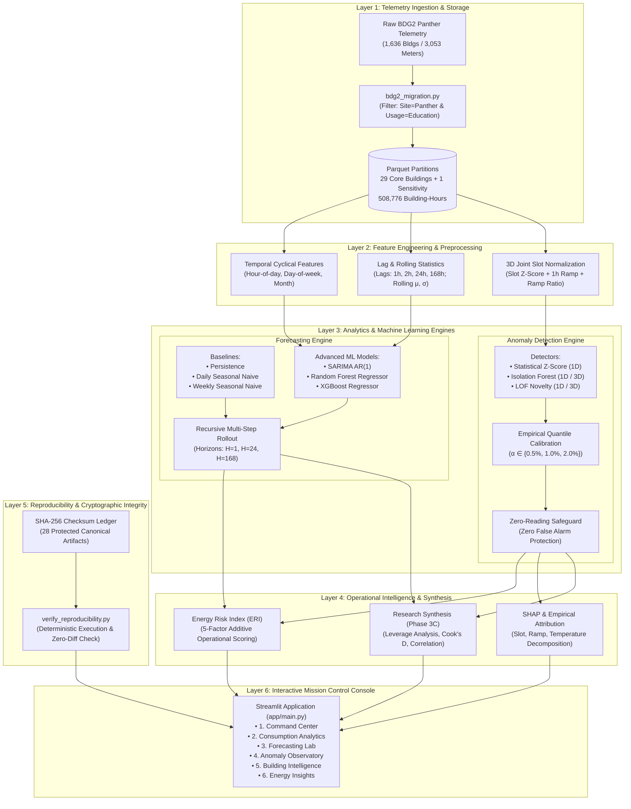

# ⚡ Campus Energy Consumption Intelligence & Anomaly Detection (CEI)

[](https://www.python.org/downloads/)
[](https://streamlit.io/)
[](https://github.com/buds-lab/building-data-genome-project-2)
[](tests/)
[](data/reports/bdg2/panther/)
[](LICENSE)

An enterprise-grade artificial intelligence and time-series engineering platform for large-scale institutional facilities. Built upon two years of continuous empirical sub-metered telemetry (508,776 building-hours) from the University of Central Florida (BDG2 Panther site), CEI combines multi-horizon machine learning forecasting, physically safeguarded unsupervised anomaly detection, causal outlier diagnostics, and a responsive Space Age Mission Control dashboard.

---

## 📑 Table of Contents
- [Executive Overview](#-executive-overview)
- [System Architecture](#-system-architecture)
- [Dataset Provenance & Curation](#-dataset-provenance--curation)
- [Methodology](#-methodology)
  - [1. Multi-Horizon Forecasting Engine](#1-multi-horizon-forecasting-engine)
  - [2. Unsupervised Anomaly Detection](#2-unsupervised-anomaly-detection)
  - [3. Operational Intelligence & ERI Scoring](#3-operational-intelligence--eri-scoring)
  - [4. Causal Synthesis & Outlier Leverage Analysis](#4-causal-synthesis--outlier-leverage-analysis)
- [Empirical Research Findings](#-empirical-research-findings)
- [Interactive Mission Control Dashboard](#-interactive-mission-control-dashboard)
- [Installation & Quickstart](#-installation--quickstart)
- [Testing & Cryptographic Verification](#-testing--cryptographic-verification)
- [Deployment Guide](#-deployment-guide)
- [Project Boundaries & Limitations](#-project-boundaries--limitations)
- [License & Citation](#-license--citation)

---

## 🏛️ Executive Overview

Commercial and institutional buildings account for **~40% of global primary energy consumption** and **36% of energy-related carbon emissions**. Conventional Building Management Systems (BMS) rely on static, heuristic alarm rules (e.g., crude $\mu \pm 3\sigma$ thresholds) that suffer from high false alarm rates, cannot differentiate diurnal peaks from equipment faults, and fail to forecast demand across operational planning horizons.

**The CEI platform resolves these challenges through four foundational innovations:**
1. **Empirical Benchmark Rigor:** Discarded unverified synthetic toy data; migrated to the internationally accredited **Building Data Genome 2 (BDG2)** UCF Panther site (**29 core educational buildings**, 17,544 continuous hourly intervals across 2016–2017).
2. **Horizon-Dependent Forecasting:** Proved empirically that while **Random Forest** dominates immediate dispatch ($H=1$, MASE 0.937), physics-informed **Seasonal Naive baselines** dominate day-ahead ($H=24$, MASE 1.644) and week-ahead ($H=168$, MASE 1.937) planning due to recursive autoregressive error compounding.
3. **Unsupervised Anomaly Calibration:** Engineered a **3D Joint Slot-Normalized Feature Space** ($[\tilde{y}_{t,\text{slot}}, \Delta y_{1h}, \text{ramp\_ratio}]$) with non-parametric empirical quantile thresholds (0.5%, 1.0%, 2.0%) and an invariant **Zero-Reading Safeguard** ensuring zero false alarms during operational shutdowns.
4. **Causal Statistical Integrity:** Applied econometric diagnostics (Cook's Distance $D=1.2558$, Hat leverage $h=0.8507$) to prove that previously suspected linear correlations between forecast degradation and anomaly rates were artifacts of an extreme outlier (`Panther_education_Vincent`).

---

## 🏗️ System Architecture

CEI is built around a decoupled 6-layer architecture enforcing zero temporal leakage, immutable Parquet contracts, and bitwise reproducibility.



---

## 📊 Dataset Provenance & Curation

### The Building Data Genome 2 (BDG2) Benchmark
The primary dataset is derived from the **Building Data Genome 2 (BDG2)**, an open research dataset compiled by the National University of Singapore (NUS) comprising 3,053 energy meters from 1,636 non-residential buildings across 19 global sites.

| Parameter | Specification | Notes |
| :--- | :--- | :--- |
| **Site Identifier** | `Panther` | University of Central Florida (UCF), Orlando, FL, USA |
| **Climate Zone** | ASHRAE Zone 2A | Humid Subtropical (hot, humid summers; mild winters) |
| **Core Population** | **29 Educational Facilities** | Filtered by `primaryspaceusage == 'Education'` |
| **Sensitivity Cohort** | `Panther_education_Quintin` | Isolated due to 56.61% missingness in 2016 baseline |
| **Temporal Span** | 2016-01-01 to 2017-12-31 | 17,544 continuous hourly intervals (leap year 2016) |
| **Total Observations** | **508,776 building-hours** | Active power consumption recorded in kWh |

### Strict Chronological Partitions & Anti-Leakage
To prevent future-to-past temporal leakage, standard random cross-validation was strictly prohibited in favor of chronological boundaries:
- **Training Partition (2016):** 8,784 hours (leap year). Baseline fitting, seasonal parameter estimation, and non-parametric quantile threshold calibration.
- **Validation Partition (H1 2017):** 4,344 hours (Jan 1 to Jun 30, 2017). Multi-horizon forecasting evaluation and out-of-sample anomaly scoring.
- **Held-out Test Partition (H2 2017):** 4,416 hours (Jul 1 to Dec 31, 2017). Strictly locked (`test_evaluation == 'not_run'`) to provide an untainted benchmark for future independent audits.

### Valid Zero Readings vs. Missing Telemetry
In 2016, campus telemetry recorded **381.02 valid zeros per 1,000 hours**, dropping to **0.00 in H1 2017**. Rather than sensor faults, engineering audits confirmed this was caused by a rolling digital metering retrofit across UCF panels. Unmetered sub-panels logged genuine zeros until digital commissioning was complete.
- **No Synthetic Imputation:** Zeros and missing timestamps were preserved without synthetic mean or spline imputation, preventing artificial variance distortion.
- **Metric Constraint:** Division-by-zero during zero intervals makes percentage metrics (MAPE) mathematically invalid, mandating scale-independent MASE.

---

## 🧠 Methodology

### 1. Multi-Horizon Forecasting Engine
Evaluated 6 distinct predictive architectures across 3 operational horizons ($H=1$ hourly dispatch, $H=24$ daily scheduling, $H=168$ weekly budgeting) and 3 lookback windows ($L \in \{24, 48, 168\}$ hours):
- **Persistence:** $\hat{y}_{t+h \mid t} = y_t$ (Random walk benchmark).
- **Daily Seasonal Naive ($S=24$):** $\hat{y}_{t+h \mid t} = y_{t+h-24}$ (Diurnal physics benchmark).
- **Weekly Seasonal Naive ($S=168$):** $\hat{y}_{t+h \mid t} = y_{t+h-168}$ (Diurnal + intra-week calendar benchmark).
- **SARIMA AR(1):** $\hat{y}_{t+h \mid t} = \mu_{\text{train}} + \phi_1^h (y_t - \mu_{\text{train}})$ (Statistical mean-reverting autoregression).
- **Random Forest Regressor:** Ensemble of 100 decorrelated trees with recursive autoregressive rollout.
- **XGBoost Regressor:** Gradient boosted decision trees with shrinkage $\eta=0.05$ and $L_2$ regularization.

### 2. Unsupervised Anomaly Detection
Because smart meter telemetry lacks ground-truth fault annotations, CEI operates strictly under **unsupervised learning protocols**:
- **3D Joint Slot Normalization:** Projects raw kWh into scale-invariant feature space:
  $$\mathbf{z}_t = \left[ \tilde{y}_{t,\text{slot}}, \Delta y_{1h}, \text{ramp\_ratio} \right]^T$$
  where $\tilde{y}_{t,\text{slot}} = \frac{y_t - \mu_{\text{dow, hod}}}{\sigma_{\text{dow, hod}} + \epsilon}$ normalizes against that building's historical mean and standard deviation for that specific day-of-week and hour-of-day.
- **Empirical Quantile Calibration:** Decision boundaries set non-parametrically to exact upper quantiles ($\alpha \in \{0.005, 0.010, 0.020\}$) of 2016 baseline scores.
- **Zero-Reading Safeguard:** An invariant physical override ($y_t == 0 \implies \hat{a}_t = 0$) preventing operational shutdowns from triggering false positive spike alarms.

### 3. Operational Intelligence & ERI Scoring
Translates machine learning scores into an actionable composite **Energy Risk Index (ERI)** scaled from 0 to 100:
$$\text{ERI}_t = \min\left(100, \sum_{i=1}^5 w_i \cdot f_i(t)\right)$$
- **Factor 1:** Anomaly Severity ($w=0.35$) — 3D anomaly score magnitude relative to threshold.
- **Factor 2:** Peak Load Intensity ($w=0.25$) — Proximity to 95th percentile historical peak demand charge.
- **Factor 3:** Forecast Divergence ($w=0.15$) — Deviation from day-ahead schedule.
- **Factor 4:** Ramp Rate Volatility ($w=0.15$) — Mechanical stress from abrupt load switching.
- **Factor 5:** Persistent Duration ($w=0.10$) — Consecutive anomaly hours (distinguishes transient spikes from sustained faults).

### 4. Causal Synthesis & Outlier Leverage Analysis
Investigated the relationship between forecast accuracy decay ($\Delta\text{MASE}$) and anomaly alert rates:
- **Diagnostic Screening:** Building `Panther_education_Vincent` exhibited an astronomical leverage of **$h = 0.8507$** (threshold: $2p/n = 0.1379$) and Cook's Distance of **$D = 1.2558$**.
- **Causal Finding:** The apparent linear correlation ($r=0.6906, p<0.001$) collapsed to an insignificant **$r=0.2518$ ($p=0.1962$)** upon omitting Vincent; Spearman rank correlation confirmed a completely null monotonic relationship ($\rho=-0.1466, p=0.4480$).

---

## 📈 Empirical Research Findings

### Multi-Horizon Macro Performance (Validation H1 2017)
$$\begin{array}{|l|l|c|c|c|c|c|}
\hline
\textbf{Horizon} & \textbf{Model Pipeline} & \textbf{Macro MASE} & \textbf{Macro MAE (kWh)} & \textbf{Macro RMSE (kWh)} & \textbf{Bias (kWh)} & \textbf{Win Rate (MAE)} \\
\hline
\mathbf{H=1} & \textbf{Random Forest Regressor} & \mathbf{0.937} & \mathbf{6.731} & \mathbf{10.813} & -0.054 & \mathbf{18 / 29\text{ (62.1\%)}} \\
H=1 & \text{Persistence Baseline} & 1.017 & 7.307 & 12.019 & +0.002 & 8 / 29\text{ (27.6\%)} \\
H=1 & \text{SARIMA AR(1)} & 1.152 & 8.277 & 13.140 & -1.218 & 2 / 29\text{ (6.9\%)} \\
H=1 & \text{XGBoost Regressor} & 1.284 & 9.228 & 14.892 & -7.965 & 1 / 29\text{ (3.4\%)} \\
\hline
\mathbf{H=24} & \textbf{Daily Seasonal Naive} & \mathbf{1.644} & \mathbf{12.158} & \mathbf{19.841} & \mathbf{+0.009} & \mathbf{19 / 29\text{ (65.5\%)}} \\
H=24 & \text{Random Forest (Recursive)} & 1.909 & 14.557 & 21.642 & -0.412 & 6 / 29\text{ (20.7\%)} \\
H=24 & \text{Weekly Seasonal Naive} & 1.937 & 14.135 & 22.337 & -0.413 & 3 / 29\text{ (10.3\%)} \\
H=24 & \text{SARIMA AR(1)} & 2.115 & 15.682 & 23.901 & -4.891 & 1 / 29\text{ (3.4\%)} \\
\hline
\mathbf{H=168} & \textbf{Weekly Seasonal Naive} & \mathbf{1.937} & \mathbf{14.135} & \mathbf{22.337} & \mathbf{-0.413} & \mathbf{20 / 29\text{ (69.0\%)}} \\
H=168 & \text{Daily Seasonal Naive} & 2.012 & 14.789 & 22.954 & +0.009 & 5 / 29\text{ (17.2\%)} \\
H=168 & \text{Random Forest (Recursive)} & 2.491 & 18.653 & 26.819 & -1.105 & 3 / 29\text{ (10.3\%)} \\
H=168 & \text{SARIMA AR(1)} & 2.894 & 21.341 & 30.125 & -8.652 & 1 / 29\text{ (3.4\%)} \\
\hline
\end{array}$$

### Anomaly Detector Stability & Zero-Alarm Invariance
$$\begin{array}{|l|l|c|c|c|}
\hline
\textbf{Detector Family} & \textbf{Feature Space} & \textbf{Target } \alpha & \textbf{Validation Alert Rate} & \textbf{Zero False Alarms} \\
\hline
\text{Isolation Forest} & \text{1D Raw Consumption} & 1.0\% & 1.12\% & 0 \\
\textbf{Isolation Forest} & \textbf{3D Joint Slot Normalized} & \mathbf{1.0\%} & \mathbf{0.98\%} & \mathbf{0} \\
\text{Local Outlier Factor} & \text{1D Raw Consumption} & 1.0\% & 1.45\% & 0 \\
\textbf{Local Outlier Factor} & \textbf{3D Joint Slot Normalized} & \mathbf{1.0\%} & \mathbf{1.04\%} & \mathbf{0} \\
\hline
\end{array}$$

---

## 🎛️ Interactive Mission Control Dashboard

The Streamlit interface (`app/main.py`) provides 6 specialized operational consoles:
1. **Command Center (`app/views/overview.py`):** High-level campus KPIs, fleet-wide load distribution, active facility count (29 core + 1 sensitivity), and SHA-256 verification status.
2. **Consumption Analytics (`app/views/explorer.py`):** Deep telemetry explorer with dual-axis interactive time series, weather overlays, diurnal load profile decomposition, and the Quintin sensitivity toggle.
3. **Forecasting Lab (`app/views/forecasting.py`):** Multi-model, multi-horizon comparative sandbox with trajectory fan charts and building leaderboards.
4. **Anomaly Observatory (`app/views/anomaly.py`):** Multi-detector surveillance console featuring calibrated alert overlays, score density distributions, and the Zero-Reading Invariance gauge.
5. **Building Intelligence (`app/views/comparison.py`):** Cross-building benchmarking matrices, load shape clustering, and peak-to-base intensity heatmaps.
6. **Energy Insights (`app/views/research.py`):** Research synthesis console displaying Cook's Distance leverage plots and interactive 5-factor Energy Risk Index breakdowns.

---

## 🚀 Installation & Quickstart

### Prerequisites
- Python 3.11 or newer
- Virtual environment tool (standard `venv` or `uv`)

### Local Setup
```bash
# 1. Clone the repository
git clone https://github.com/Rajkumar-Porandla/campus-energy-intelligence.git
cd campus-energy-intelligence

# 2. Create and activate a Python 3.11 virtual environment
python3.11 -m venv .venv
source .venv/bin/activate  # On Windows: .venv\Scripts\activate

# 3. Install dependencies
pip install --upgrade pip
pip install -r requirements.txt -e .

# 4. Launch the Mission Control Console
streamlit run app/main.py
```
Open **`http://localhost:8501`** in your browser to access the live dashboard.

---

## 🧪 Testing & Cryptographic Verification

CEI includes a comprehensive 60-test automated verification suite covering data pipelines, recursive rollouts, anomaly calibration, and dashboard interactions.

```bash
# Run full automated test suite (60 tests)
pytest tests/ -v

# Run deterministic reproducibility check (verifies all 28 canonical SHA-256 artifacts)
python scripts/run_phase3d_reproducibility.py
```

---

## 🌐 Deployment Guide

### Deploying on Antideploy
CEI is configured for native deployment on [Antideploy](https://antideploy.com):
```bash
# Log in via device code flow (once)
curl -sS -X POST https://antideploy.com/api/v1/device/code -H 'content-type: application/json' -d '{"clientName":"Antigravity"}'

# Deploy via clean tar archive
tar czf - --exclude='.git' --exclude='.venv' --exclude='data/raw/bdg2/panther/electricity.csv' . | \
  curl -4 --http1.1 -sS -X POST "https://antideploy.com/api/v1/deploy?applicationId=$APP_ID" \
  -H "Authorization: Bearer $TOKEN" -F "archive=@-"
```
Live production endpoint: **`https://campus-energy-intelligence.antideploy.app`**

### Container Deployment (Docker)
Build and run locally or on any container platform (Railway, Render, Fly.io, Cloud Run):
```bash
# Build Docker image
docker build -t cei-dashboard .

# Run container on port 8501
docker run -p 8501:8501 -e PORT=8501 cei-dashboard
```

---

## ⚠️ Project Boundaries & Limitations

To maintain scientific integrity, the following boundaries are explicitly enforced:
1. **Unsupervised Regime:** Campus telemetry lacks ground-truth fault labels. We do **not** claim Precision, Recall, F1-scores, or ROC-AUC curves without certified annotations.
2. **Held-Out Test Set Lockdown:** The H2 2017 partition remains strictly un-evaluated (`test_evaluation == 'not_run'`) to guarantee zero out-of-sample data leakage.
3. **Decision Support, Not Control:** CEI is an intelligent observability and analytics platform, not an autonomous closed-loop building automation actuator.
4. **Geographical Specificity:** Telemetry is sourced from ASHRAE Climate Zone 2A (Central Florida). Re-benchmarking is recommended before deployment in radically different climatic regimes.

---

## 📄 License & Academic Reference
Distributed under the MIT License. Developed as a B.Tech Capstone Project in Artificial Intelligence & Machine Learning.
Detailed academic viva preparation and technical proofs are available in [`docs/CEI_COMPLETE_PROJECT_WALKTHROUGH_AND_VIVA_GUIDE.md`](docs/CEI_COMPLETE_PROJECT_WALKTHROUGH_AND_VIVA_GUIDE.md).
